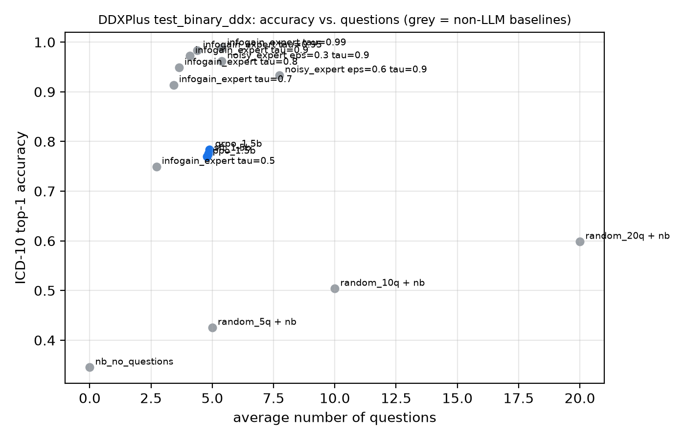
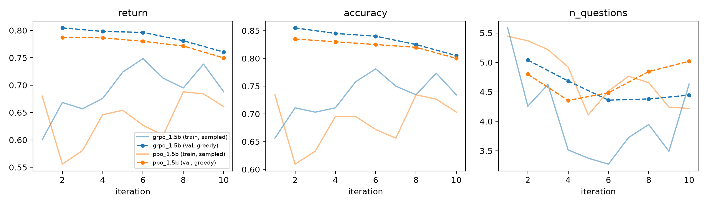

# Learning to Ask the Right Questions: Diagnostic History-Taking with RL

Semester project, LAS Lab, ETH Zürich.

An LLM "doctor" interviews a simulated patient, one question per turn, then commits to a diagnosis written as an
**ICD-10 code**. It is trained with **SFT** on expert dialogues, then with multi-turn **PPO** or **GRPO**. The goal is
to be correct while asking as few questions as possible.

## Setup

- **Patients:** [DDXPlus](https://figshare.com/articles/dataset/20043374) (1.3M synthetic patients, 49 pathologies,
  223 evidences). Each patient has an age, a sex, a chief complaint and a hidden set of evidences.
- **Questions** are matched to DDXPlus evidences by exact match, otherwise by sentence-embedding similarity. Answers
  are rendered deterministically from the ground truth. There is no LLM oracle, so the environment is cheap, exact and
  reproducible.
- **Reward:** −0.01 per question, +1 for a correct diagnosis. After 20 questions the diagnosis is forced.
- **Hard setting** (`--binary_questions --differential`): yes/no questions only (428 askable questions), and the
  answer is a ranked top-3 differential.

## Methods

| Method | Credit assignment |
|---|---|
| **SFT** | Cross-entropy on doctor tokens of successful expert dialogues |
| **PPO** | Value head on the state before each doctor turn, GAE over turns, KL-in-reward. All tokens of a turn share that turn's advantage |
| **GRPO** | G = 8 rollouts per patient, group-normalised episode return. All doctor tokens of an episode share one advantage |

```math
\text{PPO:}\quad \delta_k = r_k + V(s_{k+1}) - V(s_k), \qquad A_k = \delta_k + \lambda A_{k+1}
```

```math
\text{GRPO:}\quad A_i = \frac{R_i - \mathrm{mean}(R_{1:G})}{\mathrm{std}(R_{1:G})}
```

Patient and prompt tokens are masked out of every loss. RL starts from the SFT adapter, which is also the KL reference.

**Expert:** a Naive Bayes model over the 49 pathologies, which asks the question with the largest expected information
gain and stops once the posterior reaches τ = 0.9. Its successful dialogues are the SFT data.

## Results

DDXPlus test, hard setting. LLM: `Qwen2.5-1.5B-Instruct` + LoRA, greedy decoding, 500 patients. Baselines: 2,000 patients.

| Agent | Top-1 | Top-3 | # questions | Return |
|---|---|---|---|---|
| Naive Bayes, no questions | 34.5% | 57.9% | 0.0 | |
| 20 random questions + Naive Bayes | 59.9% | 80.3% | 20.0 | |
| Info-gain expert (τ = 0.9) | 97.2% | 99.8% | 4.1 | |
| **SFT** | 77.6% | 86.0% | 4.85 | 0.728 |
| **SFT → PPO** | 77.0% | 85.8% | 4.79 | 0.722 |
| **SFT → GRPO** | 78.4% | 87.4% | 4.89 | 0.735 |

RL budget: 10 iterations × 128 episodes on one L4 GPU. The best validation checkpoint is used for testing.




- **SFT reaches 78% top-1 versus the expert's 97%.** It learns the question format and dialogue length, but not the
  expert's question selection.
- **At this budget, PPO and GRPO stay within noise of SFT** (±1.9 points at n = 500). Sampled training return rises,
  while greedy validation return slowly falls.
- **Hypothesis for GRPO:** when all G rollouts of a patient are correct, the returns differ only by the question cost.
  Dividing by the small group std inflates that difference into advantages of about ±1, so the update mostly pushes
  for shorter dialogues.
- **Next steps:** GRPO without std normalisation, a longer RL budget, RL from a weaker (noisy-expert) SFT policy, and
  potential-based shaping with the Naive Bayes posterior.

## Usage

```bash
pip install -r requirements.txt   # put DDXPlus into data/ and unzip it
F="--binary_questions --differential"; M=Qwen/Qwen2.5-1.5B-Instruct

python baselines.py --mode eval --n 2000 $F
python baselines.py --mode make_sft --n 20000 $F
python train_sft.py --model $M --data data/sft_expert_binary_ddx.jsonl --out ckpt/sft $F
python train_rl.py --algo grpo --model $M --adapter ckpt/sft --out ckpt/grpo $F   # or --algo ppo
python evaluate.py --model $M --adapter ckpt/grpo/best --name grpo_1.5b_binary_ddx $F
python plot.py
```

To run the whole pipeline on a SLURM cluster:

```bash
sbatch --export=ALL,MODEL=$M,TAG=1.5b,SETTING=hard slurm/pipeline.sbatch
```

## Files

```
data.py        DDXPlus loading, question bank
env.py         environment: question matching, patient answers, diagnosis parsing, reward
bayes.py       Naive Bayes + information-gain expert
baselines.py   non-LLM baselines, expert SFT dialogues
llm.py         LoRA model, chat tokenisation with action masks, generation
rollout.py     batched multi-turn rollouts
train_sft.py   SFT          train_rl.py    PPO and GRPO
evaluate.py    test evaluation -> results/<name>.json
plot.py        figures (training curves are read from results/logs/)
```
